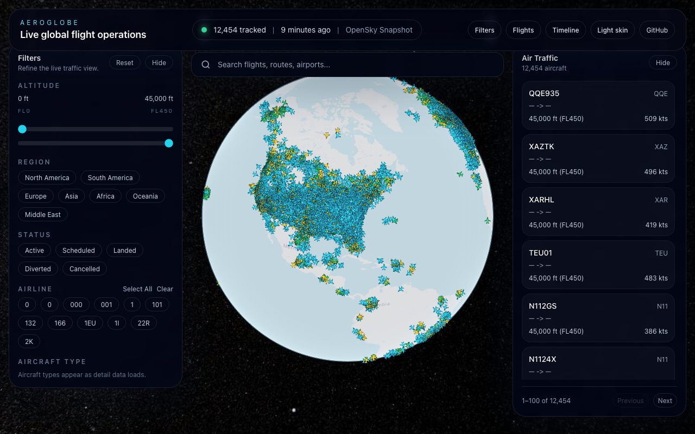
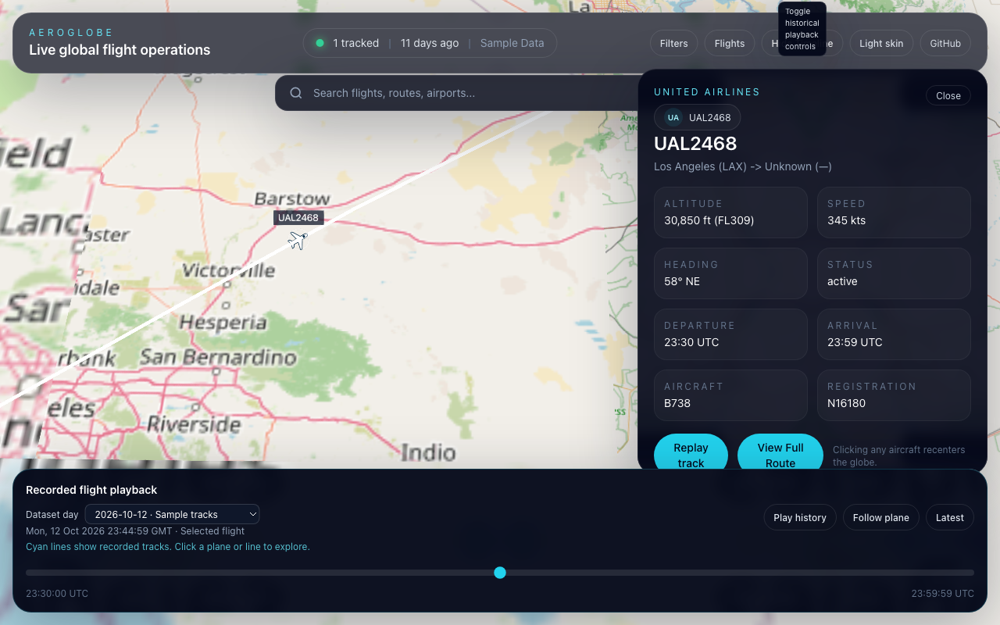

# AeroGlobe

AeroGlobe is a browser-based 3D flight tracking experience built with `React`, `TypeScript`, `CesiumJS`, `Zustand`, and an `Express` API proxy. It renders a live globe, tracks active commercial aircraft, supports search and multi-axis filtering, and provides route-focused detail panels with historical playback controls.

**Live site:** https://exios66.github.io/aeroglobe/





## Deploying

The production site is https://exios66.github.io/aeroglobe/. Publish it by building with `VITE_BASE=/aeroglobe/` and committing the contents of `dist/` onto the `gh-pages` branch. GitHub Pages serves that branch from `/`. `npm run build:check` confirms the Cesium assets and aircraft trails before the branch is updated.

Every `npm run build` first prepares a fresh `public/data/` directory with three current OpenSky observations taken 15 seconds apart, providing real sampled flight trails. If the request fails, takes more than 90 seconds, or contains no usable trails, the build uses labeled sample data. A production build therefore works without an API server or credentials. It also includes a labeled sample day for exploring longer historical paths; current OpenSky observations remain the default when available. To build entirely offline:

```bash
DATA_SOURCE=fixtures npm run build
npm run build:check
```

For local verification of the Pages path:

```bash
DATA_SOURCE=fixtures VITE_BASE=/aeroglobe/ npm run build
VITE_BASE=/aeroglobe/ npm run build:check
npm run preview
# Open http://localhost:4173/aeroglobe/
```

Vercel is also supported: import `Exios66/aeroglobe`, keep the Vite framework and `npm run build` command, and leave `VITE_BASE` unset to serve at `/`. `VITE_CESIUM_ION_TOKEN` is optional; without it the globe uses OpenStreetMap imagery. `npm run deploy` invokes a manual Vercel production deploy after account/project setup.

Use **Timeline** to choose a saved dataset day. Select a plane and choose **Replay track** to move along its recorded positions; **Follow plane** keeps the camera with it. OpenSky snapshots contain only the observations collected during that build. The labeled sample day demonstrates longer paths. History loads on demand and uses a bounded cache with duplicate requests shared.

The data directory defaults to `data/` under the app base. Set `VITE_DATA_BASE_URL` at build time to use a separately published data directory. Snapshot and sample datasets show their source and observation time in the UI. Vercel caches content-hashed JavaScript/CSS for one year and revalidates mutable HTML, data, and Cesium files; GitHub Pages controls its own HTTP cache headers.

For frontend-only development, prepare data before starting Vite:

```bash
# Three observations with real flown trail segments into public/data/
npm run data:snapshot -- --count 3 --interval 15
npm run dev

# Several snapshots spaced out, for short flown trails
npx tsx pipeline/cli.ts snapshot --count 6 --interval 120

# Offline deterministic sample data
npm run data:fixture
```

The snapshot writer feeds OpenSky state vectors into the same pipeline as adsb.lol days (`pipeline/sources/opensky.ts` → `normalize` → `segment` → `chunk` → `catalog`), so the file format is identical. Data is attributed per the catalog. OpenSky access is rate-limited; an unavailable feed falls back to sample data during builds.

## Historical data

Historical (adsb.lol) days are built and published from the owner's machine to an orphan `data` branch; point `VITE_DATA_BASE_URL` at `https://raw.githubusercontent.com/Exios66/aeroglobe/data/` (or any host serving that directory) to use them. `data:publish` only ever force-pushes the `data` branch, never `gh-pages`. No GitHub Actions are involved. Use Node 22.12+ and `git`. The design is in `docs/superpowers/specs/2026-10-14-aeroglobe-historical-first-design.md`.

```
npm run data:pull                       # fresh machine only: restore the published data branch into ./data-out (or start empty)
npm run data:tz                         # once: download time-zone polygons
npm run data:build -- --date 2026-10-12 --source adsblol --out data-out --work-dir data-work --tz pipeline/inputs/cache/timezones.geojson
npm run data:check
npm run data:publish                    # force-pushes the single-commit `data` branch
```

A full global day needs about 10 GB of free disk and about 6 GB of RAM. The `data:build` script already raises the Node heap to 6 GB; if a day still runs out of memory, edit the `--max-old-space-size` number in `package.json`. Notes:

- `data:pull` is only for a fresh machine; it refuses a non-empty `data-out`.
- Downloads go to the OS temp dir (`TMPDIR` / `TEMP`) unless `--work-dir` is given, and need about 10 GB there. A failed build keeps the downloads so re-running resumes; a successful build deletes them.
- Each publish re-uploads the whole window, since the branch is replaced by a single commit.
- `VITE_DATA_BASE_URL` is read at build time, so changing it in Vercel needs a redeploy.

An optional `GITHUB_TOKEN` raises GitHub API rate limits. Attribution: "© adsb.lol contributors, ODbL". To develop without network access, run `npm run data:fixture`.

## Tech Stack

| Layer | Technology |
| --- | --- |
| Frontend | React 18, TypeScript, Vite 7, Tailwind CSS |
| Globe | CesiumJS |
| State | Zustand, React Query |
| Backend | Node.js, Express |
| Data | OpenSky Network snapshots (`data:snapshot`), adsb.lol historical days, generated fixtures |
| Testing | Vitest, Testing Library |
| CI | GitHub workflow (lint, typecheck, test, build) |
| Hosting | GitHub Pages; optional Vercel |

## Prerequisites

- `Node.js` 22.12+
- `npm` 10+
- A WebGL-capable browser
- Optional API credentials:
  - Cesium Ion token
  - OpenSky username/password for historical playback
  - AviationStack key for richer route detail

## Environment Variables

Copy `.env.example` to `.env.local` (read by both Vite and the server, falling back to `.env`) and provide values as needed:

```bash
cp .env.example .env.local
```

## Local Setup

```bash
npm install
npm run dev:all
```

Services:

- Frontend: `http://localhost:5173`
- Backend: `http://localhost:3001`

## Scripts

- `npm run dev` starts the Vite frontend
- `npm run server` starts the Express API
- `npm run dev:all` runs both services together
- `npm run lint` checks TypeScript and React source
- `npm test` runs unit and component tests
- `npm run build` prepares snapshot/sample data and creates a production build
- `npm run build:check` verifies built asset paths, Cesium files, renderable aircraft data, and observed flight trails

## Architecture

The frontend loads the bundled static catalog and the latest hour containing aircraft, stores aircraft state in `Zustand`, and synchronizes visible flights to Cesium entities. Search and filters derive a visible set from the store. With `VITE_API_BASE_URL` configured, the app also polls `/api/flights/live` every 15 seconds and looks up aircraft details via `/api/flights/:icao24/detail`. Without an API, details come from the static flight index.

Primary folders:

- `src/` React app, state, hooks, Cesium integration, UI
- `server/` Express app, route handlers, caches, mock/live data access
- `tests/` unit and component coverage

## API Keys

- [Cesium Ion signup](https://ion.cesium.com/signup)
- [OpenSky registration](https://opensky-network.org/index.php?option=com_users&view=registration)
- [AviationStack documentation](https://aviationstack.com/documentation)
- [AeroDataBox on RapidAPI](https://rapidapi.com/aedbx-aedbx/api/aerodatabox)

## Live data verification

After adding real keys to `.env.local`:

1. **Cesium Ion** (optional): set `VITE_CESIUM_ION_TOKEN` for Cesium imagery. Without it the globe uses OpenStreetMap imagery.
2. **OpenSky** (live positions): no key needed for live `/states/all`; set `OPENSKY_USER` and `OPENSKY_PASS` for historical playback.
3. **AviationStack** (route details): set `AVIATIONSTACK_KEY` for flight detail when clicking an aircraft.

Verification steps:

```bash
# Terminal 1: start API
npm run server

# Terminal 2: start frontend
npm run dev
```

- Open `http://localhost:5173`. You should see the globe and, after ~15s, aircraft (live from OpenSky or mock fallback).
- Click an aircraft: FlightCard should appear; with AviationStack key, route/origin/destination and schedule load.
- Use search (e.g. a callsign) and filters (region, altitude, airline) to confirm filtering.
- Use "Timeline" to choose a dataset day and scrub its recorded observation window. Select a plane, choose "Replay track", and use "Follow plane" to follow its saved path.
- Toggle "Dark/Light skin" and "Filters" / "Flights" sidebars to confirm UI.
- Run `curl -s http://localhost:3001/api/flights/live | head -c 500` to confirm the API returns JSON.

When the live OpenSky feed is unavailable or returns no data, the app falls back to generated sample data. The source label shows "Sample data".

## Contributing

1. Create a feature branch from `main`.
2. Run `npm run lint`, `npm test`, `npm run build`, and `npm run build:check`.
3. Open a pull request with a concise summary and test plan.

## License

MIT. See `LICENSE`.